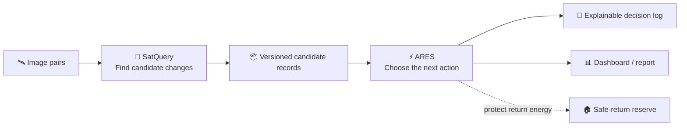

# 🛰️ ORBITRA ⚡

## **THE SATELLITE-TO-DRONE DECISION ENGINE**

### *See the change. Size the uncertainty. Spend energy like it matters.*

**ORBITRA is a research software project for energy-aware satellite-to-drone change verification.**

### *When energy is limited, what deserves the next look—and can the mission still get home?*

---

## 🌍 THE BIG IDEA

A satellite can reveal a possible change across a huge area. But a candidate is only a lead: it may be uncertain, unimportant, or expensive to verify. ORBITRA connects image-derived candidates to a decision system that weighs evidence, importance, action outcomes, and mission energy—including a protected return reserve.

**SatQuery asks:** *Where might something have changed?*  
**ARES asks:** *What should we do next, given what we know and what energy remains?*

Together, they turn change detection into a traceable, budget-aware verification workflow.

## 🚀 TWO ENGINES. ONE MISSION.

### 🔎 SatQuery — Computer Vision & Image Processing

The image-to-candidate engine. Its owner audits the selected data, loads and preprocesses supported image pairs, implements a documented baseline change detector, produces candidate regions, and evaluates confidence, uncertainty, and vision performance.

**Output:** structured candidate change records that ARES can validate and consume.

### ⚡ ARES — Energy Modelling & Intelligent Decision-Making

The mission-brain engine. It manages candidate state and evidence history, separates **importance** from **model confidence**, estimates action and mission energy, protects a return reserve with an agreed safety margin, and chooses explainable actions.

**Output:** a decision trail showing what ARES chose, why, the expected benefit and energy cost, and whether the action preserves the reserve.

### 🔗 THE HANDOFF CONTRACT

The modules connect through a documented, versioned record—not manual copy-and-paste. Before finalizing it, both owners agree on field names and types, coordinates and reference system, units, image/pair identifiers, schema version, missing values, and validation errors.

| SatQuery supplies | ARES validates and adds |
| --- | --- |
| Candidate ID and predicted change | Importance score (separate from confidence) |
| Confidence and uncertainty | Candidate status and evidence history |
| Candidate region and coordinate reference | Mission budget and return-reserve context |
| Image and pair identifiers | Feasible action, reason, estimated benefit and cost |
| Schema version and documented units | Reserve-feasibility result and decision log |

## 🧠 ARES POLICY ARENA

Five policies will be implemented and compared under defined energy budgets and return reserves:

| Policy | The play |
| --- | --- |
| **B0 · Fixed pass** | Process candidates in a predetermined order. |
| **B1 · Uncertainty first** | Spend attention on the most uncertain candidates first. |
| **B2 · Adaptive computation** | Choose how much compute each candidate warrants. |
| **B3 · Joint policy** | Choose both the candidate and its computation/action level. |
| **B4 · Greedy benefit per energy** | Prefer the best estimated immediate benefit for each unit of energy. |

Actions may include **recapture**, **stronger-model inference**, and **human review**. Each action must have documented cost and outcome assumptions. Every decision records the selected action, reason, estimated benefit, energy cost, and reserve feasibility. **No policy is declared a winner until experiments support that claim.**

## 🗺️ 32-WEEK BUILD CAMPAIGN

| Phase | Weeks | SatQuery — vision lead | ARES — decision lead | Shared checkpoint |
| --- | --- | --- | --- | --- |
| **01 · Scope** | 1–3 | Audit datasets; review change-detection research | Review energy-aware UAV research; outline simulator | Confirm scope; draft interface |
| **02 · Foundations** | 4–7 | Build loader, preprocessing, baseline detector | Design candidate-state architecture | Agree schema v1 and sample record |
| **03 · Candidate intelligence** | 8–11 | Generate regions, confidence, uncertainty | Define importance scoring and action outcomes | Review fields and end-to-end sample |
| **04 · Energy guardrails** | 12–15 | Export records; validate spatial alignment | Build energy model and return-reserve filter | First integration |
| **05 · Decision policies** | 16–19 | Integrate detector output and schema | Implement B0–B4 and decision logs | Run a simulated decision cycle |
| **06 · Evidence** | 20–23 | Evaluate vision; analyze errors | Compare policies at matched budgets; run ablations | Review comparable results |
| **07 · Mission picture** | 24–27 | Support integration; validate vision outputs | Build explainable dashboard and simulator flow | Exercise end-to-end workflow |
| **08 · Finish & present** | 28–32 | Final vision validation and documentation | Final integration and reporting | Clean-checkout run; report and presentation |

## 👥 TEAM SETUP

The project synopsis lists **three students**. This module split is for **two active developers**; it does not assign or remove the third listed student.

- **Developer 1:** Computer Vision & Image Processing Lead — **SatQuery**
- **Developer 2:** Energy Modelling & Intelligent Decision-Making Lead — **ARES**

Each owner works in their own module folder. Shared interface and integration work is coordinated by both.

## ⚙️ SHARED-REPO OPERATING RULES

Both owners work on the same **`main`** branch, keeping module changes in separate folders.

1. Pull the latest `main` before starting work and again before pushing.
2. Coordinate pushes so they do not overlap; use focused commits.
3. Never force-push, reset shared history, or commit inside the other owner’s folder.
4. Keep module documentation current after meaningful updates: what changed, how to run it, checks performed, limitations, and interface changes.
5. For every update, share the commit hash, changed files, checks performed, and any action needed from the other owner.
6. At integration, update both module READMEs and document an end-to-end example that loads real SatQuery records, validates them in ARES, applies a policy under a defined budget and reserve, logs the result, and shows candidate status plus dashboard/report output.

**Completion means the documented example runs from a clean checkout.** Report only checks that were actually performed. Keep simulated actions clearly labelled; do not imply that software simulation represents a real drone flight.

## 📁 REPOSITORY MAP

- [`ARES/`](ARES/README.md) — energy modelling, candidate management, policies, simulation, and dashboard.
- [`SatQuery/`](SatQuery/README.md) — image inputs, change detection, candidate generation, and vision evaluation.
- [`README.md`](README.md) — this project overview and shared workflow.

## 🧪 REALITY CHECK

**Current state: repository scaffold and project documentation.** The module code, experiments, measured results, and integration example are not yet claimed as complete. No physical drone is controlled or flown by this project.

The first shared technical checkpoint is concrete: inspect a representative SatQuery record, agree on schema v1, and document ARES energy units, reserve rules, and action assumptions.

---

### **ORBITRA**
#### *From orbital clues to energy-smart decisions.*

**Find the signal. Spend with intent. Keep the way home in reserve.**

