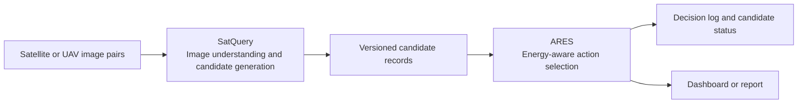

# 🛰️ ORBITRA

### Satellite-scale awareness. Energy-smart verification.

**Spot possible changes across wide areas. Decide what deserves a closer look. Spend limited mission energy deliberately.**

ORBITRA is a proposed research software system for **energy-aware satellite-to-drone change verification**. It connects image-derived change candidates to an explainable decision engine that weighs evidence, action costs, and the energy needed to return safely.

> **The research focus:** once possible changes have been detected, how should a limited-energy mission decide what to inspect or compute next?

ORBITRA is a software prototype and mission simulator. It does **not** control or fly a physical drone. Recapture and verification outcomes must be labelled as simulated when real repeated UAV observations are unavailable.

---

## The mission flow

SatQuery identifies **where a change may have occurred**. ARES decides **what to do about each candidate**, subject to mission energy and a return reserve. The modules meet at a documented, versioned record interface.

## Two modules, one system

### 🔎 SatQuery — image understanding

Owned by the **Computer Vision & Image Processing Lead**. This module audits the selected dataset, loads and preprocesses supported image pairs, implements a documented baseline change detector, generates candidate regions, and reports confidence, uncertainty, and vision evaluation results.

### ⚡ ARES — energy-aware decisions

Owned by the **Energy Modelling & Intelligent Decision-Making Lead**. This module manages candidate state, models energy use and action outcomes, protects a return-energy reserve, compares decision policies, and explains each selected action.

### 🔗 The handoff

SatQuery provides candidate ID, confidence, uncertainty, region, predicted change, image/pair identifiers, coordinate reference, units where applicable, and schema version. ARES validates and enriches those records with mission context, evaluates feasible actions, and logs the resulting decision and candidate status. The owners must agree on field definitions and missing-value behavior before finalizing the interface.

## ARES policies under study

ARES will implement and compare five policies under a defined energy budget and return reserve:

| Policy | Decision approach |
| --- | --- |
| **B0 — Fixed pass** | Process candidates in a predetermined order. |
| **B1 — Uncertainty first** | Prioritize candidates with the greatest uncertainty. |
| **B2 — Adaptive computation** | Choose how much computation to spend. |
| **B3 — Joint policy** | Jointly choose which candidate to act on and how much computation to use. |
| **B4 — Greedy benefit per energy** | Choose the action with the best estimated immediate benefit relative to its energy cost. |

These are strategies to implement and evaluate; **no policy is claimed to perform best before experiments are run**. Each decision should record its selected action, reason, estimated benefit, energy cost, and return-reserve feasibility.

## 32-week development roadmap

| Weeks | SatQuery | ARES | Joint checkpoint |
| --- | --- | --- | --- |
| **1–3** | Dataset audit and change-detection literature | Energy-aware UAV research and simulator outline | Confirm scope and draft interface |
| **4–7** | Loader, preprocessing, baseline detector | Candidate-state architecture | Agree schema v1 and sample record |
| **8–11** | Candidate regions, confidence, uncertainty | Importance scoring and action-outcome models | Review fields and end-to-end sample |
| **12–15** | Export and alignment checks | Energy model and return-reserve filter | First integration |
| **16–19** | Detector/schema integration | Policies B0–B4 and decision logs | Simulated decision cycle |
| **20–23** | Vision evaluation and error analysis | Matched-budget experiments and ablations | Compare results |
| **24–32** | Integration support and vision validation | Dashboard and end-to-end integration | Validate, report, and present |

This roadmap translates the synopsis schedule into module ownership. It is a plan, not a claim that work is complete.

## Team and repository workflow

The synopsis lists **three students**. This plan assigns module ownership to **two active developers** and does not assign or remove the third listed student.

Both module owners work on the shared `main` branch in their separate folders. Pull the latest `main` before starting and before pushing, coordinate pushes so they do not overlap, keep commits focused, and do not force-push or rewrite shared history. Each meaningful update should keep the relevant module README current with the change, run instructions, checks performed, limitations, and interface changes. During integration, update both module READMEs and this overview as needed.

## Repository map

- [`ARES/`](ARES/README.md) — ARES responsibilities, schedule, interface dependency, and ongoing implementation log.
- [`SatQuery/`](SatQuery/README.md) — SatQuery responsibilities, interface dependency, and module status.

## Current status

**Scaffold and project documentation only.** No module code, experiments, or measured results are claimed yet. The first shared technical milestone is to review a representative SatQuery record, agree on the interface, and document the ARES energy units, reserve rule, and action assumptions.
